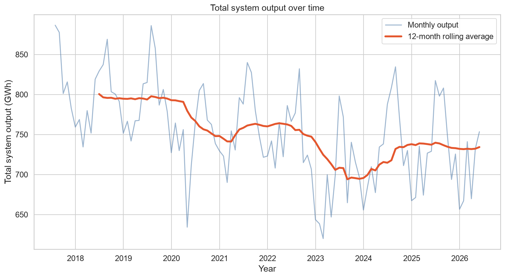
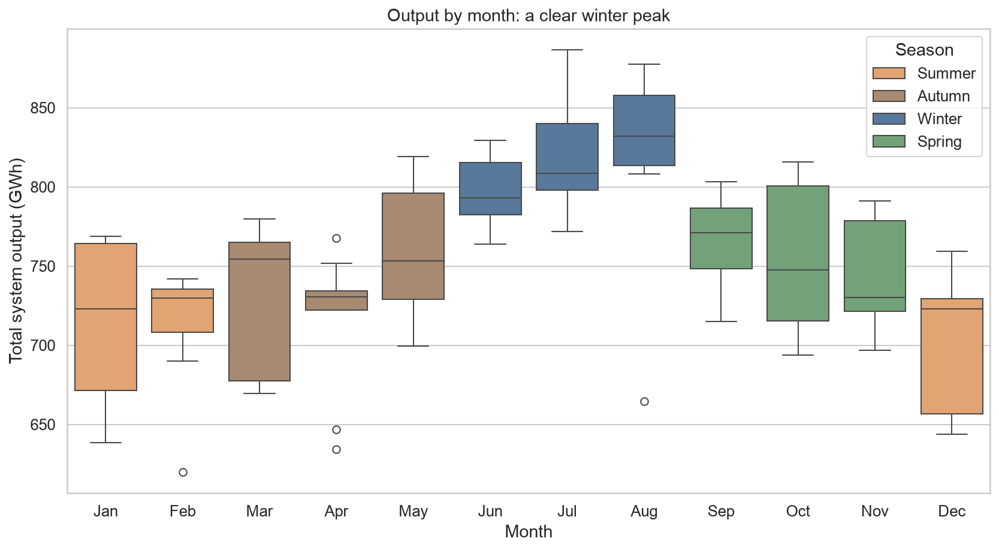
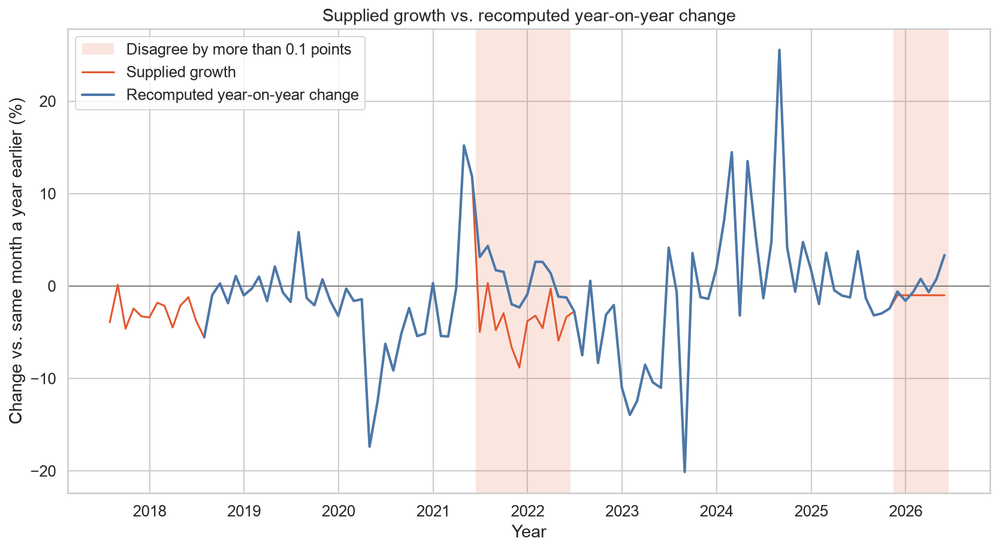
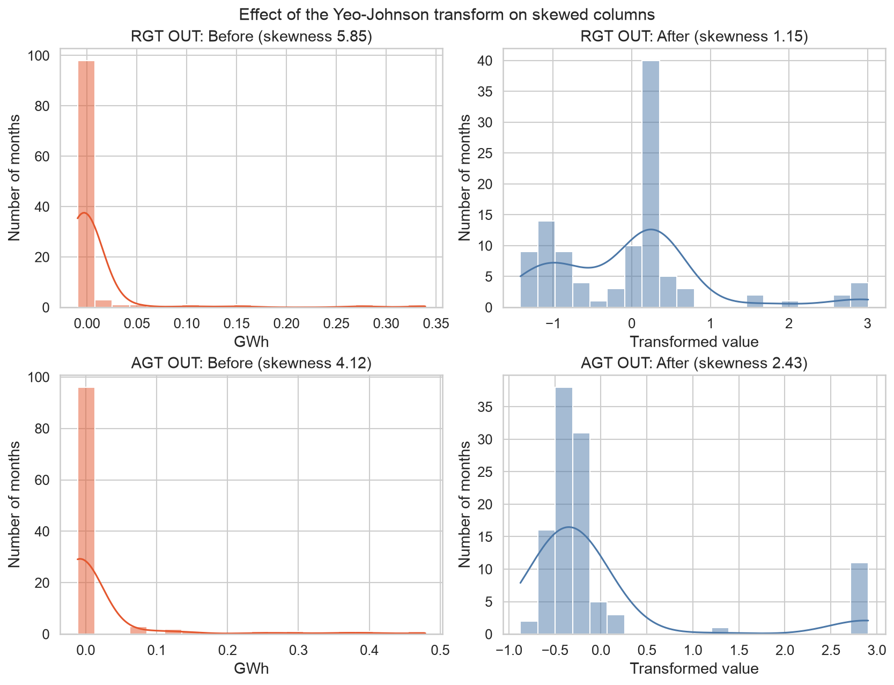
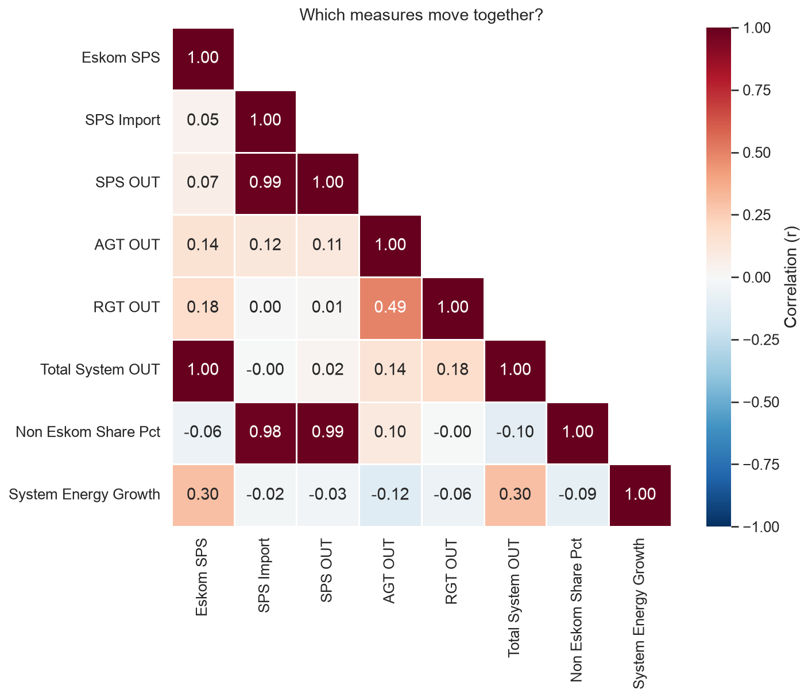

# Data Science Pipeline

A Python data science pipeline that cleans, transforms and explores real City of Cape Town open data. It demonstrates three stages of the data science process: **data cleaning**, **data transformation**, and **data exploration & visualisation**.

Built by a group of three as a data science assignment at CPUT (ICT: Applications Development). The repository holds the code, and a companion instructional video explains the concepts and the solution step by step.


---

## Overview

Each stage takes the saved output of the one before it:

```
raw CSV  →  1. Cleaning  →  2. Transformation  →  3. Exploration & visualisation
            (flags issues)   (adds useful columns)   (summary + 5 charts)
```

| Stage | Module | What it does |
|---|---|---|
| **1. Data cleaning** | `src/clean.py` | Parses UTC date text into correct South African month-end dates, converts percentage text to numbers, fixes a column-name typo, and flags suspicious values (zeros, placeholders, outliers, totals that don't add up). Raw measurements are never changed or deleted. |
| **2. Data transformation** | `src/transform.py` | Converts units (kWh to GWh), adds time features (year, month, season), change and rolling-average features, rebuilds a partly missing column and validates it, applies a power transform to skewed columns, scales selected columns, and encodes season and month. |
| **3. Exploration & visualisation** | `src/explore.py` | Prints a written summary of statistics and key findings, then draws five charts, each answering one question. |

## Data

| | |
|---|---|
| **Source** | [City of Cape Town Open Data Portal](https://odp-cctegis.opendata.arcgis.com/) |
| **Dataset** | System Energy (`System_Energy.csv`) |
| **Size** | 107 monthly records, July 2017 to May 2026, 10 columns |
| **Content** | Monthly electricity system figures in kWh (Eskom supply, imports, outputs, total system output) plus growth percentages |

The raw file lives in `data/raw/` and is never edited. All cleaning is done in code, so the process is reproducible.

> Check the dataset's licence and terms on the portal and add them here.

## Project structure

```
data-science-pipeline/
├── data/
│   ├── raw/
│   │   └── System_Energy.csv                 # original file, untouched
│   └── processed/
│       ├── system_energy_clean.csv           # output of stage 1
│       └── system_energy_transformed.csv     # output of stage 2
├── src/
│   ├── clean.py                              # stage 1
│   ├── transform.py                          # stage 2
│   └── explore.py                            # stage 3
├── figures/                                  # charts saved by stage 3
├── main.py                                   # interactive runner
├── requirements.txt
├── .gitignore
└── README.md
```

## Getting started

**Requirements:** Python 3.10 or newer.

```bash
# 1. Clone the repository
git clone https://github.com/<your-username>/data-science-pipeline.git
cd data-science-pipeline

# 2. Create and activate a virtual environment
python -m venv .venv
source .venv/bin/activate        # Windows: .venv\Scripts\activate

# 3. Install dependencies
pip install -r requirements.txt
```

## Usage

Run the interactive pipeline:

```bash
python main.py
```

You will see a menu:

```
1. Clean & transform data
2. Visualise data
3. Exit
```

| Choice | What happens |
|---|---|
| **1. Clean & transform** | If a cleaned file already exists in `data/processed/`, cleaning is skipped and transformation runs on it. Otherwise it cleans first, then asks before moving on to transformation, and then asks before moving on to visualisation. |
| **2. Visualise** | If transformed data exists it goes straight to the charts. If not, it tells you what is missing and asks before running each earlier stage. |
| **3. Exit** | Quits the program. |

Saved files are reused to save time. If you change any code or the raw data, run `python main.py --rebuild` to ignore the saved files and rebuild everything from the raw CSV. The program also warns you when a saved file is older than the code or data that produces it.

Each chart is saved to `figures/` and also pops up on screen. Close a chart's window to move to the next one. If you are on a machine without a display, set the environment variable `MPLBACKEND=Agg` to save the charts without showing them.

## Key findings

All figures below are produced by the code in this repository.

- **Seasonality:** average output peaks in July (about 823 GWh) and is lowest in December (about 702 GWh). Winter months average 14.7% more than summer months.
- **Trend:** comparing full calendar years, average monthly output fell from about 795 GWh in 2018 to about 732 GWh in 2025 (-7.9%). The 12-month rolling average falls until late 2023, then recovers slightly and levels off.
- **Data quality:**
  - `F12_Month_Ave` is missing in 66 of 107 rows. It matches the 12-month rolling average of the growth column to within 0.007, so 55 of the gaps were reconstructed and flagged. The first 11 months stay empty.
  - The supplied growth column disagrees with a recomputed year-on-year change in 19 months: seven are a constant -1.00% placeholder (November 2025 to May 2026) and twelve are consecutive months from June 2021 to May 2022. The data does not explain why.
  - Total output fails a consistency check (supply minus imports plus outputs) in 3 months, the largest being July 2021, out by 15,000 kWh.
- **Relationships:** total output is almost entirely Eskom supply (r = 0.999). Among the other measures, imports and SPS output are the most closely related (r = 0.99).

## Charts

| Chart | Question it answers |
|---|---|
|  | **Trend:** how has total output changed over time? |
|  | **Seasonality:** does output follow a seasonal cycle? |
|  | **Growth check:** does the supplied growth match our own year-on-year calculation? |
|  | **Distributions:** what did the power transform do to skewed columns? |
|  | **Correlations:** which measures move together? |

## Limitations

- The dataset is small (107 rows), and each calendar month has only 8 or 9 observations, so the seasonal pattern is a general indication, not a precise estimate.
- The Yeo-Johnson transform reduced skewness in the AGT and RGT columns but did not remove it, because those columns mix small negative values with occasional large positive spikes.
- Values flagged as unusual are not necessarily errors. They are marked for a closer look and left in the data.
- Correlation shows that measures move together, not that one causes the other.
- The cause of the growth-column mismatch (June 2021 to May 2022) is not known from the data alone.


## Tools

Python, pandas, NumPy, Matplotlib, seaborn, scikit-learn

## Authors

- [Thando Njikalana](https://github.com/TNjikelana)
- [Lingomso Pasiya](https://github.com/LingomsoPasiya)
- [Nipho Ngomane](https://github.com/Nipho-codes)

CPUT, ICT: Applications Development - Data Science